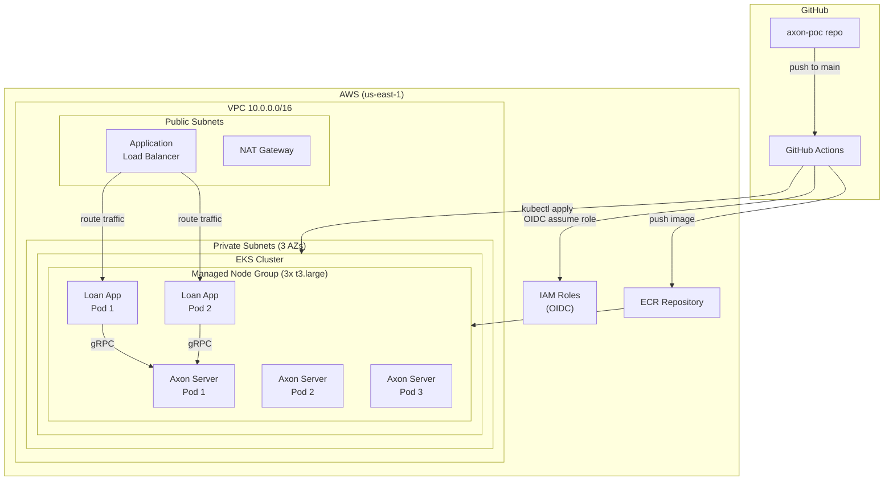

# Deployment Architecture

## Architecture Diagram



### Text Alternative
```
GitHub Repository
  → Push to main triggers GitHub Actions
  → GitHub Actions assumes AWS IAM role via OIDC
  → Builds Docker image, pushes to ECR
  → Configures kubectl, applies K8s manifests to EKS

AWS (us-east-1):
  VPC (10.0.0.0/16)
    Public Subnets (3 AZs):
      - ALB (routes /api/loans to app pods)
      - NAT Gateway (single, PoC)
    Private Subnets (3 AZs):
      - EKS Cluster (K8s 1.29)
        - Managed Node Group (3x t3.large)
          - Axon Server StatefulSet (3 pods, one per AZ)
          - Loan App Deployment (2 pods)
  ECR: axon-poc-loan-originations
  IAM: OIDC provider + deploy role
```

## Network Flow

1. **External → App**: Client → ALB (public subnet) → App pods (private subnet, port 8080)
2. **App → Axon Server**: App pods → Axon Server ClusterIP service (gRPC port 8124)
3. **GitHub Actions → AWS**: OIDC token → STS AssumeRoleWithWebIdentity → short-lived credentials
4. **Nodes → Internet**: Private subnet → NAT Gateway → Internet (for pulling images, etc.)

## Resource Sizing Summary

| Component | Instance/Size | Count | Memory | CPU |
|-----------|--------------|-------|--------|-----|
| EKS Nodes | t3.large | 3 | 8 GiB each | 2 vCPU each |
| Axon Server pods | — | 3 | 2Gi limit | 2000m limit |
| App pods | — | 2 | 1Gi limit | 1000m limit |
| EBS (data) | gp3 | 3 | 10Gi each | — |
| EBS (events) | gp3 | 3 | 50Gi each | — |

**Total cluster capacity**: 24 GiB RAM, 6 vCPU
**Total pod requests**: ~9 GiB RAM, 3.5 vCPU (comfortable headroom)

## Deployment Flow

```
1. CloudFormation deploy (nested stacks):
   networking → eks-cluster → ecr → addons

2. GitHub Actions CI/CD (on push to main):
   Build app → Push to ECR → Configure kubectl → Apply K8s manifests

3. Kubernetes applies:
   StorageClass → Namespace → Axon Server StatefulSet → App Deployment → Ingress
```
