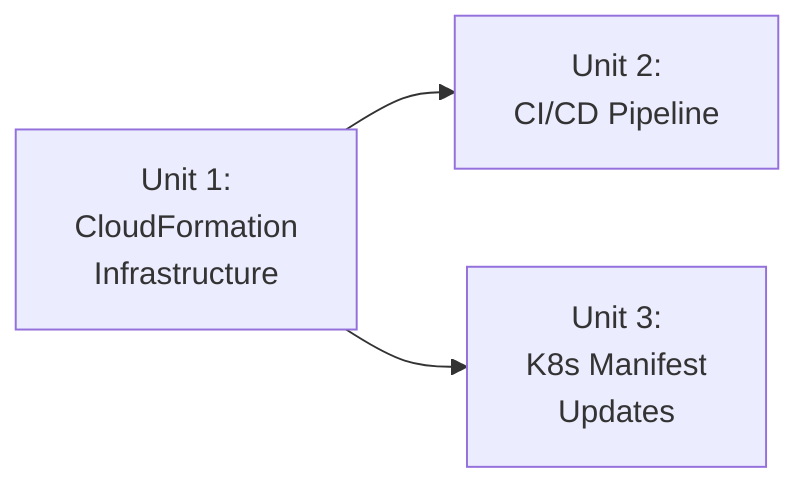

# Unit of Work Dependencies

## Dependency Matrix

| Unit | Depends On | Reason |
|------|-----------|--------|
| Unit 1: CloudFormation Infrastructure | None | Foundational — must be provisioned first |
| Unit 2: CI/CD Pipeline | Unit 1 | Needs ECR URI, EKS cluster name, and AWS account ID from infrastructure outputs |
| Unit 3: K8s Manifest Updates | Unit 1 | Needs ECR repository URI to replace placeholder |

## Execution Sequence

### Sequence:
1. **Unit 1** (CloudFormation) — Must be created first. Outputs provide values for other units.
2. **Unit 2 + Unit 3** (CI/CD + K8s manifests) — Can be developed in parallel after Unit 1 outputs are known. In practice, Unit 3 is consumed by Unit 2 during deployment.

## Integration Points

### Unit 1 → Unit 2
- **ECR Repository URI**: CI/CD workflow needs this to tag and push images
- **EKS Cluster Name**: CI/CD workflow needs this to configure kubectl
- **AWS Region**: Shared configuration (us-east-1)

### Unit 1 → Unit 3
- **ECR Repository URI**: K8s manifest needs actual image path
- **Namespace**: Already defined as `axon-poc` (no change needed)

### Unit 2 → Unit 3
- **Deployment Step**: CI/CD pipeline applies the K8s manifests to the cluster
- **Image Tag**: Pipeline injects the built image tag into manifests at deploy time
