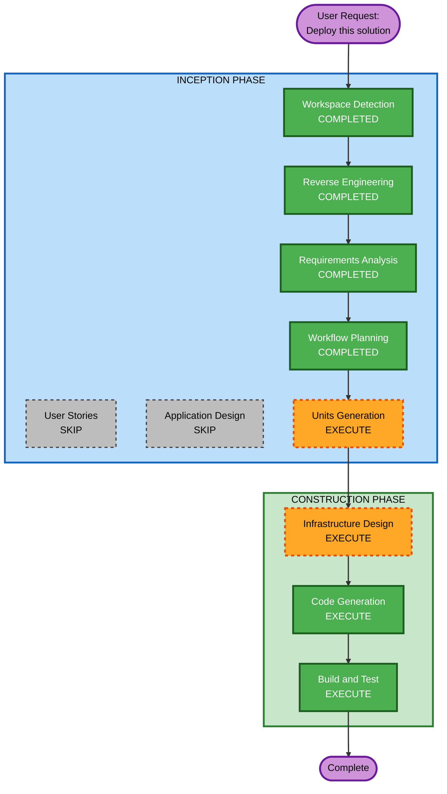

# Execution Plan

## Detailed Analysis Summary

### Transformation Scope
- **Transformation Type**: Infrastructure provisioning + CI/CD automation
- **Primary Changes**: Create CloudFormation templates for EKS/ECR/VPC, GitHub Actions CI/CD pipeline, fix K8s manifest placeholders
- **Related Components**: k8s/ manifests (update), Dockerfile (no change), application code (no change)

### Change Impact Assessment
- **User-facing changes**: No — deployment infrastructure only
- **Structural changes**: No — application architecture unchanged
- **Data model changes**: No — no schema changes
- **API changes**: No — REST API unchanged
- **NFR impact**: No — PoC-level, no NFR extensions enabled

### Component Relationships
- **Primary Component**: New CloudFormation infrastructure templates
- **Infrastructure Components**: EKS cluster, ECR repo, VPC, IAM, EBS CSI, ALB Controller
- **Existing K8s Manifests**: Update ECR_REPO placeholder
- **CI/CD**: New GitHub Actions workflow
- **Application Code**: No changes (already built and containerized)

### Risk Assessment
- **Risk Level**: Low — greenfield infrastructure (new CloudFormation stacks), no changes to running systems
- **Rollback Complexity**: Easy — CloudFormation stack delete removes all infrastructure
- **Testing Complexity**: Simple — deploy and verify health endpoints respond

## Workflow Visualization



### Text Alternative
```
Phase 1: INCEPTION
- Workspace Detection (COMPLETED)
- Reverse Engineering (COMPLETED)
- Requirements Analysis (COMPLETED)
- User Stories (SKIP)
- Workflow Planning (COMPLETED)
- Application Design (SKIP)
- Units Generation (EXECUTE)

Phase 2: CONSTRUCTION
- Functional Design (SKIP)
- NFR Requirements (SKIP)
- NFR Design (SKIP)
- Infrastructure Design (EXECUTE)
- Code Generation (EXECUTE)
- Build and Test (EXECUTE)
```

## Phases to Execute

### INCEPTION PHASE
- [x] Workspace Detection (COMPLETED)
- [x] Reverse Engineering (COMPLETED)
- [x] Requirements Analysis (COMPLETED)
- [x] User Stories - SKIP
  - **Rationale**: Infrastructure/deployment work with no user-facing features or personas
- [x] Workflow Planning (COMPLETED)
- [ ] Application Design - SKIP
  - **Rationale**: No new application components; existing app code is unchanged. Only infrastructure and CI/CD code needed.
- [ ] Units Generation - EXECUTE
  - **Rationale**: Three distinct units of work (CloudFormation IaC, GitHub Actions CI/CD, K8s manifest fixes) that can be sequenced

### CONSTRUCTION PHASE
- [ ] Functional Design - SKIP
  - **Rationale**: No business logic to design; infrastructure patterns are well-established
- [ ] NFR Requirements - SKIP
  - **Rationale**: PoC-level quality; all NFR extensions opted out
- [ ] NFR Design - SKIP
  - **Rationale**: No NFR requirements to incorporate
- [ ] Infrastructure Design - EXECUTE
  - **Rationale**: Need to map CloudFormation resources, define stack structure, plan AWS service interactions
- [ ] Code Generation - EXECUTE (ALWAYS)
  - **Rationale**: Generate CloudFormation templates, GitHub Actions workflow, update K8s manifests
- [ ] Build and Test - EXECUTE (ALWAYS)
  - **Rationale**: Provide deployment instructions and validation steps

### OPERATIONS PHASE
- [ ] Operations - PLACEHOLDER

## Estimated Timeline
- **Total Stages to Execute**: 4 (Units Generation, Infrastructure Design, Code Generation, Build and Test)
- **Estimated Duration**: Medium (multiple files across Terraform, GitHub Actions, K8s)

## Success Criteria
- **Primary Goal**: Fully automated deployment of Axon PoC to AWS EKS from GitHub push
- **Key Deliverables**:
  - CloudFormation templates for EKS, ECR, VPC, IAM
  - GitHub Actions workflow for CI/CD
  - Updated K8s manifests with proper ECR URI
  - Deployment documentation
- **Quality Gates**:
  - CloudFormation templates pass `aws cloudformation validate-template`
  - GitHub Actions workflow syntax is valid
  - K8s manifests pass validation (kubectl dry-run)
