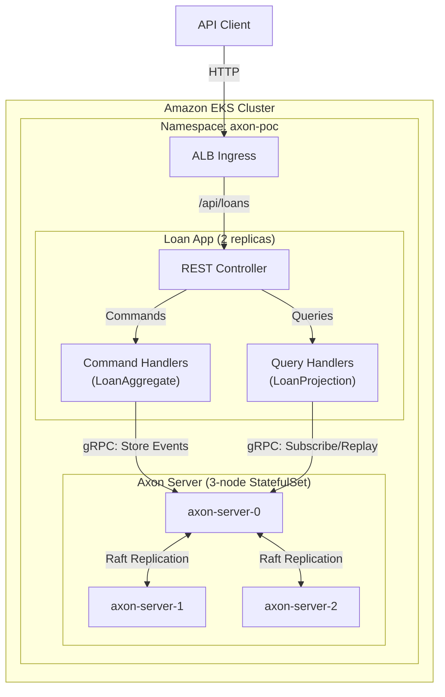
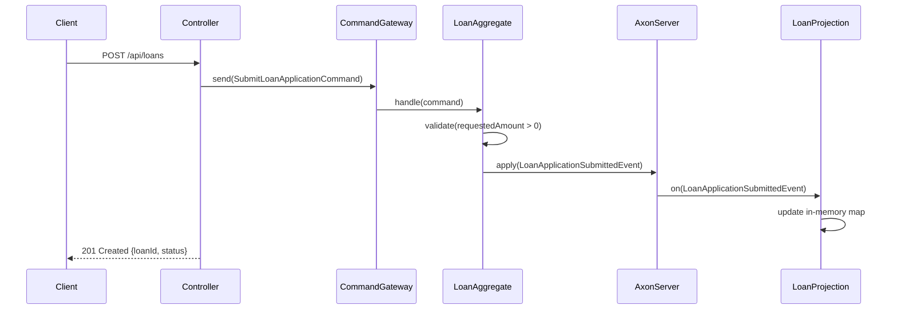

# System Architecture

## System Overview
The Axon PoC Loan Originations system is a Spring Boot application implementing CQRS and Event Sourcing via Axon Framework. The command side processes writes through an event-sourced aggregate, while the query side maintains an in-memory read model built from event replay. The application is containerized and deployed to Amazon EKS with a 3-node Axon Server cluster as the event store.

## Architecture Diagram

## Component Descriptions

### REST API Layer (LoanController)
- **Purpose**: HTTP interface for loan operations
- **Responsibilities**: Accept REST requests, dispatch commands via CommandGateway, dispatch queries via QueryGateway
- **Dependencies**: Axon CommandGateway, QueryGateway
- **Type**: Application

### Command Side (LoanAggregate)
- **Purpose**: Enforce business rules and emit domain events
- **Responsibilities**: Validate commands against current state, emit events, rebuild state from event stream
- **Dependencies**: Axon Framework (aggregate, command handlers, event sourcing handlers)
- **Type**: Application (Domain Core)

### Query Side (LoanProjection)
- **Purpose**: Build and maintain read model from events
- **Responsibilities**: Handle events to update in-memory view, respond to queries
- **Dependencies**: Axon Framework (event handlers, query handlers)
- **Type**: Application (Read Model)

### Axon Server Cluster
- **Purpose**: Event store, command routing, query routing
- **Responsibilities**: Persist events, route commands to correct aggregate, distribute queries, enable event replay
- **Dependencies**: EBS gp3 volumes for persistence
- **Type**: Infrastructure

## Data Flow

## Integration Points
- **External APIs**: None (self-contained PoC)
- **Databases**: H2 in-memory (token/saga store only), Axon Server event store (primary persistence)
- **Third-party Services**: None

## Infrastructure Components
- **Container Runtime**: Docker (multi-stage build, amazoncorretto:17-alpine)
- **Orchestration**: Kubernetes (EKS)
- **Event Store**: Axon Server 2024.1.2 (3-node StatefulSet with Raft consensus)
- **Storage**: EBS gp3 (10Gi data + 50Gi events per Axon Server node)
- **Networking**: ClusterIP services, ALB Ingress (internal scheme)
- **Deployment Model**: 2-replica Deployment for app, 3-replica StatefulSet for Axon Server
- **HA Strategy**: Pod topology spread across AZs for Axon Server
