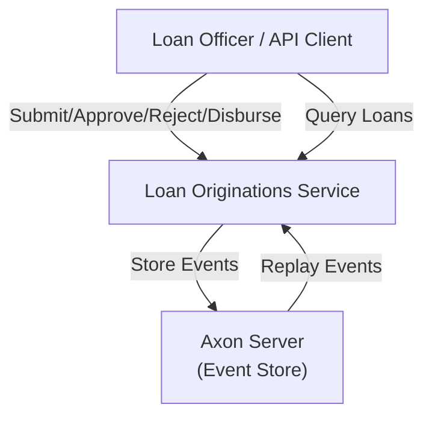

# Business Overview

## Business Context Diagram

## Business Description
- **Business Description**: A Loan Originations proof-of-concept system that manages the full lifecycle of loan applications using CQRS and Event Sourcing patterns. The system separates write operations (commands) from read operations (queries), storing all state changes as immutable events.
- **Business Transactions**:
  1. **Submit Loan Application** — An applicant submits a new loan request with their name, requested amount, and purpose
  2. **Approve Loan** — An authorized approver approves a submitted loan with a specific approved amount
  3. **Reject Loan** — An authorized reviewer rejects a submitted loan with a reason
  4. **Disburse Loan** — An approved loan is disbursed to a specified account
  5. **Query Loans** — Retrieve all loans, a specific loan by ID, or filter loans by status
- **Business Dictionary**:
  - **Loan Application**: A request for funds submitted by an applicant
  - **Aggregate**: The domain entity (LoanAggregate) that enforces business rules on the command side
  - **Projection**: The read-model that builds a queryable view from events
  - **Event Sourcing**: Storing state as a sequence of immutable events rather than mutable records
  - **CQRS**: Command Query Responsibility Segregation — separating write and read models

## Component Level Business Descriptions

### Loan Originations Application
- **Purpose**: Process loan applications through their lifecycle (submit → approve/reject → disburse)
- **Responsibilities**: Accept commands via REST API, validate business rules in the aggregate, emit events, build query projections
