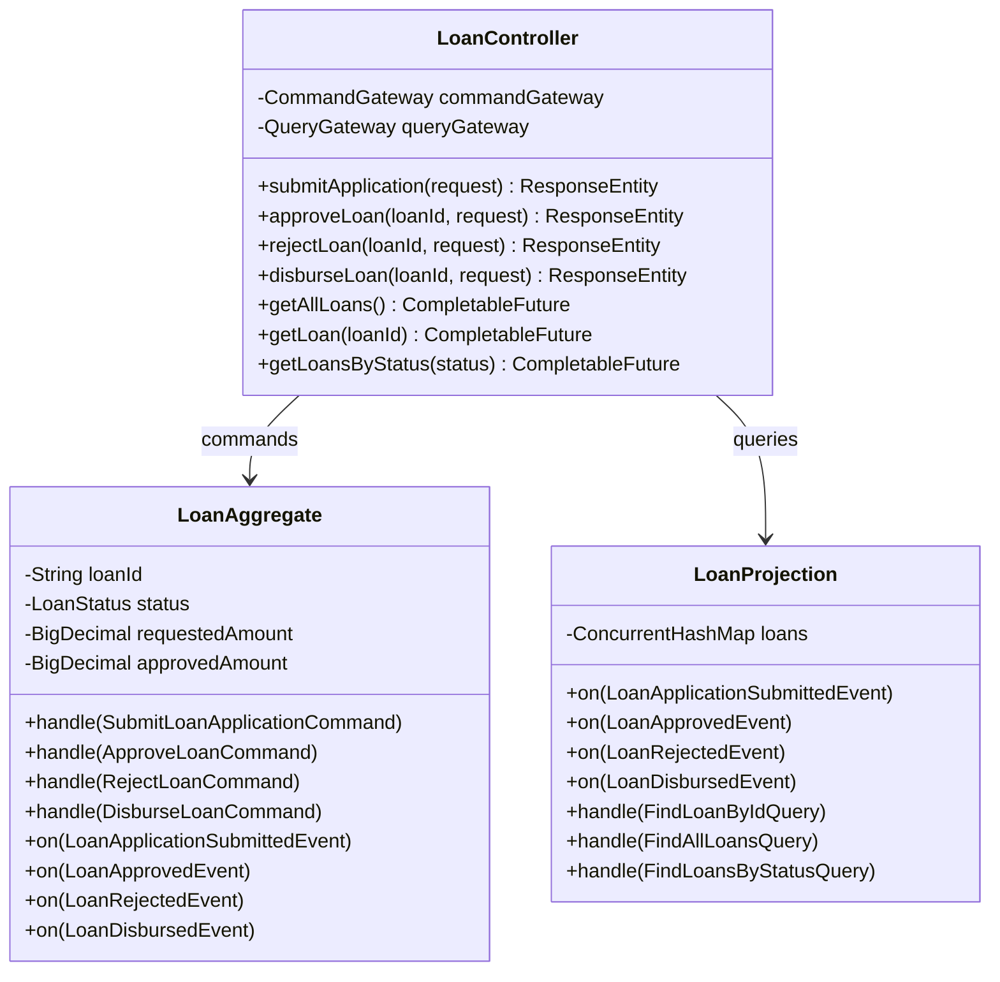

# Code Structure

## Build System
- **Type**: Gradle (Kotlin DSL)
- **Configuration**:
  - `build.gradle.kts` — Plugin config, dependencies, Kotlin compiler options
  - `settings.gradle.kts` — Root project name: `axon-poc-loan-originations`
  - Spring Boot 3.3.0, Axon Framework 4.9.4, Kotlin 1.9.24, JDK 17

## Key Classes/Modules

### Existing Files Inventory
- `src/main/kotlin/com/capitalone/loans/axonpoc/AxonPocApplication.kt` — Spring Boot application entry point
- `src/main/kotlin/com/capitalone/loans/axonpoc/api/LoanController.kt` — REST API controller + request DTOs
- `src/main/kotlin/com/capitalone/loans/axonpoc/command/Commands.kt` — Command message definitions
- `src/main/kotlin/com/capitalone/loans/axonpoc/command/Events.kt` — Event message definitions
- `src/main/kotlin/com/capitalone/loans/axonpoc/command/LoanAggregate.kt` — Event-sourced aggregate + LoanStatus enum
- `src/main/kotlin/com/capitalone/loans/axonpoc/query/LoanProjection.kt` — Query-side projection + query messages + view model
- `src/main/resources/application.yml` — Spring Boot + Axon configuration
- `Dockerfile` — Multi-stage Docker build
- `k8s/axon-server.yaml` — Axon Server StatefulSet + Services
- `k8s/loan-app.yaml` — Application Deployment + Service + Ingress
- `k8s/storage-class.yaml` — EBS gp3 StorageClass

## Design Patterns

### CQRS (Command Query Responsibility Segregation)
- **Location**: Entire application architecture
- **Purpose**: Separate write model (aggregate) from read model (projection) for independent scaling and optimization
- **Implementation**: CommandGateway for writes, QueryGateway for reads, separate handler classes

### Event Sourcing
- **Location**: LoanAggregate
- **Purpose**: Store state as sequence of events, enabling full audit trail and temporal queries
- **Implementation**: @EventSourcingHandler methods rebuild state from events; no direct database writes

### Aggregate Pattern (DDD)
- **Location**: LoanAggregate
- **Purpose**: Enforce business invariants as a consistency boundary
- **Implementation**: Command handlers validate state, then emit events via AggregateLifecycle.apply()

### Projection Pattern
- **Location**: LoanProjection
- **Purpose**: Build denormalized read models optimized for queries
- **Implementation**: @EventHandler methods update ConcurrentHashMap; @QueryHandler methods serve queries

## Critical Dependencies

### Axon Framework
- **Version**: 4.9.4
- **Usage**: Command handling, event sourcing, query dispatching, aggregate lifecycle
- **Purpose**: Core CQRS/ES framework

### Spring Boot
- **Version**: 3.3.0
- **Usage**: Web framework, DI container, actuator health checks
- **Purpose**: Application framework and HTTP server

### Axon Server
- **Version**: 2024.1.2 (Docker image)
- **Usage**: Event store, command bus router, query bus router
- **Purpose**: Infrastructure backbone for event persistence and message routing

### H2 Database
- **Version**: Runtime dependency (Spring-managed)
- **Usage**: Token store and saga store (in-memory)
- **Purpose**: Tracking processor position persistence (PoC only)
