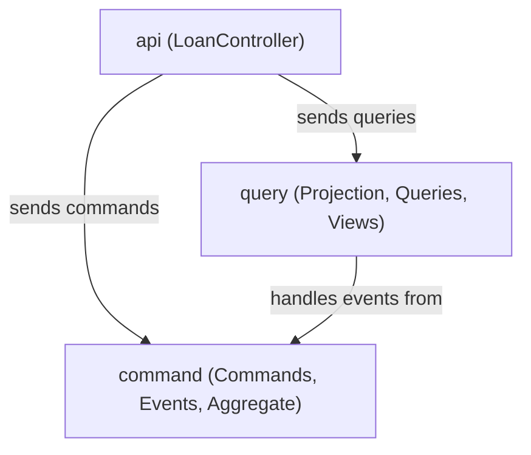

# Dependencies

## Internal Dependencies

### api depends on command
- **Type**: Compile
- **Reason**: Controller creates and sends command objects

### api depends on query
- **Type**: Compile
- **Reason**: Controller sends query objects and returns view types

### query depends on command
- **Type**: Compile
- **Reason**: Projection handles event types defined in command package

## External Dependencies

### org.axonframework:axon-spring-boot-starter
- **Version**: 4.9.4
- **Purpose**: Core CQRS/ES framework with Spring Boot auto-configuration
- **License**: Apache 2.0

### org.springframework.boot:spring-boot-starter-web
- **Version**: 3.3.0 (managed)
- **Purpose**: REST API, embedded Tomcat, Spring MVC
- **License**: Apache 2.0

### org.springframework.boot:spring-boot-starter-actuator
- **Version**: 3.3.0 (managed)
- **Purpose**: Health checks, metrics endpoints for K8s probes
- **License**: Apache 2.0

### com.fasterxml.jackson.module:jackson-module-kotlin
- **Version**: Managed by Spring Boot BOM
- **Purpose**: Kotlin data class serialization support
- **License**: Apache 2.0

### org.jetbrains.kotlin:kotlin-reflect
- **Version**: 1.9.24
- **Purpose**: Reflection support required by Spring and Axon
- **License**: Apache 2.0

### com.h2database:h2
- **Version**: Managed by Spring Boot BOM (runtime only)
- **Purpose**: In-memory database for token/saga store
- **License**: MPL 2.0 / EPL 1.0

### org.axonframework:axon-test
- **Version**: 4.9.4 (test only)
- **Purpose**: Aggregate and saga test fixtures
- **License**: Apache 2.0

### org.springframework.boot:spring-boot-starter-test
- **Version**: 3.3.0 (test only)
- **Purpose**: Test utilities, MockMvc, JUnit 5 integration
- **License**: Apache 2.0
