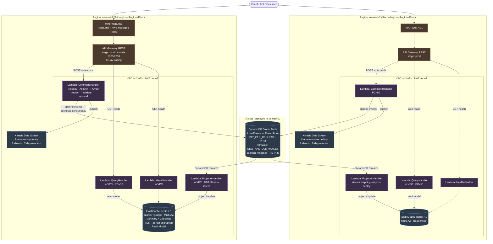

# AWS-Native Loan Originations — Architecture

CQRS / Event Sourcing on native AWS services, deployed active-active across two
regions. This diagram is derived from the CDK stacks in
[`infra/stacks/global-stack.ts`](../infra/stacks/global-stack.ts) and
[`infra/stacks/regional-stack.ts`](../infra/stacks/regional-stack.ts).

## Component reference

| Layer | Resource | Notes |
|-------|----------|-------|
| Edge | WAF Web ACL | Rate limiting (2000/IP) + AWS managed rule sets (Common, KnownBadInputs) |
| API | API Gateway REST | `prod` stage, throttle 1000/2000, X-Ray tracing, CORS enabled |
| Compute | Command Lambda | Node 20, ARM64, provisioned concurrency 50; replays events, validates, appends |
| Compute | Query Lambda | In VPC, provisioned concurrency 50; reads only from Redis |
| Compute | Projector Lambda | In VPC; consumes DynamoDB Streams, updates Redis read model |
| Compute | Health Lambda | In VPC; health check against Redis |
| Event Store | DynamoDB Global Table `LoanEvents` | Active-active, PAY_PER_REQUEST, PITR, streams, deletion protection, RETAIN |
| Event Bus | Kinesis Data Stream | Per region, 2 shards, 7-day retention |
| Read Model | ElastiCache Redis 7.1 | `cache.r7g.large`, Multi-AZ, 1 primary + 2 replicas, TLS + at-rest encryption |
| Network | VPC | 3 AZs, NAT gateway per AZ |

## CQRS / Event Sourcing flow

- **Write path**: Client → WAF → API Gateway → Command Lambda → append event to the
  DynamoDB event store (optimistic concurrency) and publish to Kinesis. The command
  handler rebuilds aggregate state by replaying events before validating business rules.
- **Read path**: Client → WAF → API Gateway → Query Lambda → read from ElastiCache
  Redis. The query side never reads from the event store.
- **Projection**: DynamoDB Streams → Projector Lambda → update the Redis read model.

## Multi-region notes

- One `GlobalStack` (the DynamoDB Global Table) is deployed in `us-east-1` and
  replicates to `us-west-2` bi-directionally.
- Two identical `RegionalStack` deployments (`us-east-1` primary, `us-west-2` secondary)
  each provide a full VPC, WAF, API Gateway, four Lambdas, Multi-AZ Redis, and a
  regional Kinesis stream. Both regions serve reads and writes.
- The projector's DynamoDB Stream event source is wired in CDK for the primary region
  only; the secondary region's stream mapping is configured post-deploy via the AWS CLI
  (cross-region stream mapping is not natively supported in CDK).
- Route53 latency-based routing is referenced in `demo.sh` and the CDK `domainName`
  context but is **not** created by the current stacks — DNS is left for manual setup.
