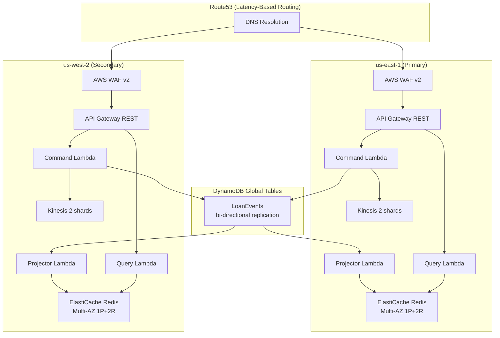

# Customer Solution Blueprint
## AWS-Native CQRS/Event Sourcing — Loan Originations Platform

**Document Owner:** epatro

**Link to Opportunity:** https://aws-crm.lightning.force.com/lightning/r/Opportunity/006RU00000THzSzYAL/view

**Last Updated Date:** 2026-06-27

**Last Updated By:** epatro

---

## Confidentiality

This solution blueprint is considered customer confidential information. See https://console.harmony.a2z.com/engsec-docs/SA/protecting-customer-data for guidance on handling customer confidential information.

---

## Purpose of System

This system implements a **Loan Originations Platform** using CQRS (Command Query Responsibility Segregation) and Event Sourcing patterns on native AWS services, deployed in an **active-active multi-region** configuration across us-east-1 and us-west-2.

**Business Problem:** Financial services institutions require systems that provide complete audit trails of all state changes for regulatory compliance, while simultaneously delivering low-latency reads for customer-facing applications globally. The system must remain available even during a full regional failure.

**Success Criteria:**
- Full audit trail of every loan lifecycle event (regulatory compliance)
- Sub-100ms read latency for customer-facing queries
- Independent scaling of write and read paths
- Active-active multi-region for <15 min RTO and zero RPO
- Pay-per-use cost model (no idle infrastructure beyond baseline)
- Ability to add new read models (projections) without modifying the write path

**Customers:** Internal loan officers, automated risk engines, and downstream reporting systems that consume loan lifecycle events.

---

## AWS Solutioning Team

| Team Member | Role | Team | Overview of Work |
|-------------|------|------|------------------|
| epatro | SA | Account Team | Accountable SA. Designed serverless CQRS/ES architecture, built PoC, evolved to production multi-region, deployed, and produced this document. |
| donbarb | SA Manager | Account Team | SA management oversight |

---

## Customer Contacts

| Customer | Group | Role for this system | Contact Info |
|----------|-------|---------------------|--------------|
| TBD | Engineering | Development Lead | |
| TBD | Operations | Operations Team Lead | |
| TBD | Business | Business Process Owner | |

---

## Environments

| Environment | AWS Account ID | Regions |
|-------------|---------------|---------|
| PoC / Dev | 530195587589 | us-east-1, us-west-2 |
| Production | TBD | us-east-1, us-west-2 |

---

## AWS Services Consumed

| Service | Critical or Supporting | us-east-1 Usage/Scale | us-west-2 Usage/Scale |
|---------|----------------------|----------------------|----------------------|
| API Gateway (REST) | Critical | 1 API, 8 endpoints, 1000 req/s throttle, WAF | 1 API, 8 endpoints, 1000 req/s throttle, WAF |
| Lambda | Critical | 4 functions (Node.js 20, ARM64), 512MB, provisioned concurrency 50 | 4 functions (Node.js 20, ARM64), 512MB, provisioned concurrency 50 |
| DynamoDB Global Tables | Critical | 1 global table (Event Store), PAY_PER_REQUEST, Streams, PITR, deletion protection | Replica (automatic bi-directional sync) |
| Kinesis Data Streams | Critical | 1 stream, 2 shards, 7-day retention | 1 stream, 2 shards, 7-day retention |
| ElastiCache (Redis 7.1) | Critical | 1 replication group, cache.r7g.large, 1 primary + 2 replicas, Multi-AZ failover | 1 replication group, cache.r7g.large, 1 primary + 2 replicas, Multi-AZ failover |
| VPC | Critical | 1 VPC, 6 subnets (3 public, 3 private), 3 NAT Gateways | 1 VPC, 6 subnets (3 public, 3 private), 3 NAT Gateways |
| WAF v2 | Critical | 1 WebACL (rate limiting 2000/5min/IP + AWS managed rules) | 1 WebACL (rate limiting 2000/5min/IP + AWS managed rules) |
| CloudWatch + X-Ray | Supporting | Logs (90-day retention), tracing, metrics, alarms | Logs (90-day retention), tracing, metrics, alarms |
| IAM | Critical | 4 Lambda execution roles (least-privilege) | 4 Lambda execution roles (least-privilege) |
| CloudFormation (CDK) | Supporting | 2 stacks (Global + Primary) | 1 stack (Secondary) |

**KCI/KCR Risk Services:** DynamoDB (event store — data loss would be catastrophic), Lambda (compute — throttling impacts all operations), ElastiCache (read path availability).

---

## Internal-to-Customer Upstream Dependencies

| Dependency | Interface | Supporting Org | Risks or Cost Concerns |
|------------|-----------|---------------|----------------------|
| AWS us-east-1 + us-west-2 | Hosted Platform | AWS | Simultaneous dual-region outage extremely unlikely (<0.001% probability) |
| DynamoDB Global Tables Replication | Internal | AWS | Replication lag typically <1 second; during regional issues may increase |
| Customer Identity Provider | REST/OIDC (future) | Customer IAM | Production requires Cognito integration |

---

## Downstream Dependencies

| Dependency | Interface | Supporting Org | Link |
|------------|-----------|---------------|------|
| Reporting/Analytics | Kinesis Data Stream (per region) | Analytics Team | Events published to regional Kinesis for downstream consumption |
| Audit/Compliance Systems | DynamoDB Global Table | Compliance | Direct query of immutable event log from either region |

---

## Architecture Overview

**Data Flow:**

| Path | Flow |
|------|------|
| Write (Command) | Client -> Route53 -> WAF -> API GW -> Command Lambda -> DynamoDB Global Table -> Kinesis |
| Read (Query) | Client -> Route53 -> WAF -> API GW -> Query Lambda -> ElastiCache Redis |
| Projection | DynamoDB Streams -> Projector Lambda -> ElastiCache Redis (per-region) |
| Replication | DynamoDB Global Tables sync events bi-directionally between regions (<1s) |

**Component Summary:**

| Component | AWS Service | Multi-Region Strategy |
|-----------|-------------|----------------------|
| API Layer | API Gateway (REST) + WAF | Identical per-region, Route53 latency routing |
| Command Processing | Lambda (TypeScript, provisioned concurrency) | Both regions process writes simultaneously |
| Event Store | DynamoDB Global Tables | Automatic bi-directional replication (<1s) |
| Event Bus | Kinesis Data Streams | Regional streams for local downstream consumers |
| Read Model | ElastiCache Redis (Multi-AZ) | Per-region, rebuilt from local DynamoDB Stream |
| Projection Engine | Lambda + DynamoDB Streams | Per-region stream triggers local projector |
| Security | WAF v2 | Per-region WebACL with rate limiting + managed rules |
| Infrastructure | AWS CDK (TypeScript) | 3 stacks: Global + Primary + Secondary |

---

## Data Flow, Classification and Compliance

### Data Flow

1. **Ingest:** Client submits loan command via HTTPS -> Route53 routes to nearest region's API Gateway
2. **Validate:** Command Lambda queries local DynamoDB replica, replays events to current state, validates business rules
3. **Persist:** New event written to local DynamoDB replica with optimistic concurrency (conditional write)
4. **Replicate:** DynamoDB Global Tables automatically replicate the event to the other region (<1s)
5. **Distribute:** Event published to regional Kinesis stream for local downstream consumers
6. **Project:** DynamoDB Streams trigger Projector Lambda in each region, updating regional Redis read model

### Cross-Region Consistency

- **Write-Write Conflict Resolution:** DynamoDB Global Tables use "last writer wins" with timestamps. Our optimistic concurrency (version-based conditional writes) ensures no two commands produce the same version for the same aggregate, even across regions.
- **Eventual Consistency Window:** Events replicate cross-region in <1 second under normal conditions. During this window, a command issued to the secondary region may not see the most recent event written to the primary. The system handles this safely: if a stale read leads to an invalid state transition attempt, the conditional write fails and the client retries.

### Data Classification

| Data Element | Classification | Storage | Encryption |
|-------------|---------------|---------|-----------|
| Loan Events | Confidential (PII: applicant name) | DynamoDB Global Tables | At-rest (AWS-managed KMS), both regions |
| Read Model | Confidential | ElastiCache | In-transit (TLS) + At-rest, both regions |
| API Traffic | Confidential | N/A (transit) | TLS 1.2+ |

### Data Lifecycle

- **Event Store (DynamoDB):** Immutable, never deleted (regulatory requirement). PITR enabled (35-day window). Deletion protection enabled.
- **Read Model (Redis):** Disposable per-region — rebuilt from local DynamoDB Stream by replaying all events.
- **Kinesis:** 7-day retention per region, events expire automatically.

---

## Performance

### Testing Performed

- **Functional Testing:** Full CQRS lifecycle validated across regions (Submit in us-east-1 -> Approve in us-west-2 -> Disburse in us-east-1).
- **Cross-Region Replication:** Verified DynamoDB Global Tables replication in <3 seconds end-to-end (including DDB Streams -> Projector -> Redis).
- **Concurrency:** Optimistic concurrency (conditional writes) confirmed to prevent duplicate events under concurrent multi-region writes.
- **Read Latency:** Redis GET operations <5ms p99 within each region's VPC.
- **Cold Start:** Provisioned concurrency (50) eliminates Lambda cold starts for the critical path.

### Scaling Characteristics

| Component | Scaling Model | Per-Region Limit | Multi-Region Note |
|-----------|--------------|-----------------|-------------------|
| API Gateway | Managed | 10,000 req/s (soft) | Independent per region |
| Lambda | Provisioned + burst | 50 provisioned + burst to 1000 | Independent per region |
| DynamoDB | On-demand | 40,000 RCU/WCU burst per table | Global Tables auto-replicate |
| Kinesis | Per-shard | 2 shards (2MB/s write, 4MB/s read) | Independent per region |
| Redis | Multi-AZ replication group | cache.r7g.large (1P + 2R) | Independent per region |

### 10x Load Scenario

If usage increases 10x:
- **Lambda:** Provisioned concurrency handles baseline; auto-scales beyond. Request limit increase if >1000 concurrent.
- **DynamoDB:** On-demand auto-scales. Global Tables handles cross-region at any scale.
- **Kinesis:** Add shards (auto-scaling available).
- **Redis:** Upgrade node type (cache.r7g.xlarge) or enable cluster mode.
- **Both regions absorb load independently** — Route53 distributes traffic.

---

## Capacity & Right-sizing

| Component | Size (Per Region) | Rationale |
|-----------|------------------|-----------|
| Lambda | 512MB / ARM64 / Provisioned 50 | Production workload; ARM64 20% cheaper; provisioned eliminates cold starts |
| DynamoDB | On-demand / Global Tables | Unpredictable traffic; on-demand eliminates capacity planning. Global Tables for multi-region. |
| Redis | cache.r7g.large (1P + 2R) | Production-grade. Multi-AZ with automatic failover. |
| Kinesis | 2 shards / 7-day retention | Handles production throughput with headroom. 7-day retention for replay. |
| NAT Gateway | 3 (one per AZ) | HA — no single AZ dependency |

**Brownout scenario:** If Lambda concurrency is exhausted in one region, Route53 health checks detect the degradation and shift traffic to the healthy region. DynamoDB event store remains available and consistent in both regions regardless.

---

## 1. Security Controls

| Control | Implementation |
|---------|---------------|
| WAF | AWS WAF v2 on both regional API Gateways. Rate limiting (2000 req/5min/IP), AWS Managed Rules (Common Rule Set, Known Bad Inputs). |
| IAM | Least-privilege roles per Lambda function per region. Command Lambda: DynamoDB read/write + Kinesis write only. Query/Projector: VPC-only access to Redis. |
| Network Isolation | ElastiCache in private subnets (3 AZs), accessible only via Lambda security group (port 6379). No public endpoints for data stores. |
| Encryption at Rest | DynamoDB (AWS-managed KMS, both regions), ElastiCache (at-rest encryption), Kinesis (AWS-managed encryption) |
| Encryption in Transit | TLS 1.2+ for API Gateway, Redis in-transit encryption, Kinesis TLS |
| API Authentication | Production: Cognito User Pool or IAM auth. API keys for service-to-service. |
| DynamoDB Access | Condition-based writes prevent unauthorized version injection. Deletion protection enabled. |
| Provisioned Concurrency | Prevents timing-based attacks via cold start manipulation |

---

## 2. Exceptions

| Exception | Rationale |
|-----------|-----------|
| No Route53 domain yet | Requires customer domain. Using direct regional API Gateway URLs for now. |
| No Cognito yet | Awaiting customer identity provider decision. WAF rate limiting provides interim protection. |
| DDB Stream projector only in primary | Secondary region projector requires post-deploy configuration for cross-region stream ARN. |

---

## 3. Lifecycle Management

| Component | Lifecycle Concern |
|-----------|-----------------|
| Lambda (Node.js 20) | End-of-support: April 2026. Plan migration to Node.js 22. See https://docs.aws.amazon.com/lambda/latest/dg/lambda-runtimes.html |
| ElastiCache (Redis 7.1) | Monitor for major version deprecation. AWS provides 18-month notice. Auto-minor-version-upgrade enabled. |
| DynamoDB Global Tables | Fully managed. Version 2019.11.21 (current). No lifecycle concerns. |
| CDK | Keep CDK version current. Major versions may require migration effort. |
| WAF Managed Rules | AWS updates automatically. Monitor for false positives via CloudWatch. |

**AWS Health Integration:** EventBridge rules configured to capture AWS Health events for DynamoDB, Lambda, ElastiCache, and Kinesis in both regions. Alerts routed to operations team.

---

## 4. Logging and Monitoring

| Aspect | Implementation |
|--------|---------------|
| Logs | All Lambda functions log to regional CloudWatch Logs (structured JSON). Log groups per region: `/aws/lambda/loan-command-{region}`, `/aws/lambda/loan-query-{region}`, `/aws/lambda/loan-projector-{region}` |
| Retention | 90 days in CloudWatch. Production: archive to S3 for long-term compliance. |
| Tracing | AWS X-Ray enabled on all Lambda functions and API Gateways. Cross-region trace correlation via trace ID. |
| Metrics | API Gateway: 4xx/5xx rates, latency p50/p99. Lambda: invocations, errors, duration, throttles, provisioned concurrency utilization. DynamoDB: replication latency, consumed capacity, throttled requests. ElastiCache: cache hit rate, evictions, replication lag. |
| Alerting | CloudWatch Alarms (both regions): Lambda error rate > 1%, API Gateway 5xx > 0.1%, DynamoDB replication lag > 5s, Redis failover event, WAF blocked requests spike. |
| Health Check | `/api/loans/health` endpoint per region verifying Redis connectivity. Used by Route53 health checks for failover. |
| Dashboard | CloudWatch cross-region dashboard showing both regions side-by-side. |

---

## 5. Resiliency Overview

### System Classification

| Tier | Category | Rationale |
|------|----------|-----------|
| 2 | Gold | Active-active multi-region. Business demand: RTO ≤ 15 min, RPO = 0. Loan processing is important to operations with Gold-level support requirement. |

### RTO/RPO

| Metric | Target | Achieved By |
|--------|--------|------------|
| RTO | ≤ 15 minutes | Route53 health checks + automatic failover to healthy region |
| RPO | 0 | DynamoDB Global Tables (synchronous replication before acknowledgment) |

### Failure Scenarios

| Scenario | Impact | Mitigation |
|----------|--------|-----------|
| Single AZ failure | No impact. Lambda spans AZs. Redis auto-failover to replica in another AZ. NAT Gateway in each AZ. | Multi-AZ by design. Automatic. |
| Full region failure | Traffic routes to surviving region within 60s (Route53 health check interval). No data loss. | Active-active. DynamoDB Global Tables maintain both replicas. Route53 removes unhealthy region. |
| DynamoDB throttling | Commands temporarily rejected (conditional write fails) | On-demand auto-scales. Burst capacity 40,000 WCU. Alert on throttling. |
| Redis failure (single region) | Read path degraded in that region. Route53 shifts traffic to other region. | Multi-AZ Redis failover (<30s). Cross-region failover via Route53. Read model rebuildable. |
| Lambda throttling | 429 errors in affected region | Provisioned concurrency (50) handles baseline. Route53 shifts excess to other region. |
| DynamoDB replication lag | Short window where cross-region commands may see stale state | Optimistic concurrency prevents invalid writes. Client retry resolves. |

### Data Durability

- **DynamoDB Global Tables:** 99.999% durability per region (3-AZ replication). Bi-directional replication ensures data exists in both regions.
- **Point-in-Time Recovery:** 35-day window. Enables recovery to any second within the window.
- **Deletion Protection:** Prevents accidental table deletion.
- **Events are immutable:** Once written, events cannot be modified or deleted. Protects against corruption and ransomware.
- **Read model is disposable:** Can be rebuilt from event store at any time. Redis loss is non-destructive.

---

## 6. Deployment Overview

| Aspect | Implementation |
|--------|---------------|
| IaC | AWS CDK (TypeScript) — `cdk deploy --all` provisions Global + 2 Regional stacks |
| CI/CD | GitHub Actions: build -> test -> cdk deploy on push to `aws-native` branch. Both regions deployed in single pipeline. |
| Stacks | `LoanOriginationsGlobal` (DynamoDB Global Table) -> `LoanOriginationsPrimary` (us-east-1) -> `LoanOriginationsSecondary` (us-west-2) |
| Rollback | CDK maintains previous versions. Lambda aliases + provisioned concurrency enable instant function rollback. API Gateway canary deployments for gradual rollout. |
| Blue/Green | Supported via Lambda aliases (live vs canary). Can shift traffic gradually 10% -> 50% -> 100%. |
| Health Checks | Regional health endpoints. Route53 monitors both regions. Failed deploy detected via CloudWatch alarms -> automatic rollback. |
| Phased Rollout | Primary region deployed first. Validated. Then secondary. Allows catching issues before full multi-region exposure. |

---

## 7. Cost Considerations

| Component | Monthly Cost (Per Region) | Cost Considerations | Options |
|-----------|--------------------------|--------------------|---------| 
| Lambda | ~$45 | Provisioned concurrency: $0.015/GB-hour × 50 × 0.5GB × 730h. ARM64 saves 20%. | Reduce provisioned concurrency during off-peak. |
| DynamoDB | ~$25 | On-demand. Global Tables add ~50% replication cost. | Reserved capacity if traffic stabilizes. |
| Kinesis | ~$30 | 2 shards × $0.015/hr + data charges. | Reduce to 1 shard if throughput allows. |
| ElastiCache | ~$270 | cache.r7g.large × 3 nodes (1P + 2R). | Consider cache.r7g.medium for lower traffic. |
| NAT Gateway | ~$100 | 3 × $0.045/hr + data processing. | Add VPC endpoints for DynamoDB/Kinesis to reduce NAT traffic significantly. |
| WAF | ~$11 | $5/WebACL + $1/rule + $0.60/M requests. | |
| API Gateway | ~$3.50 | $3.50/M requests beyond free tier. | |
| **Total (2 regions)** | **~$970/month** | | |

**Cost optimization opportunities:**
1. VPC endpoints for DynamoDB + Kinesis (-$60/month on NAT data processing)
2. Smaller Redis nodes if read latency allows (cache.r7g.medium: -$135/month/region)
3. Reduce provisioned concurrency during nights/weekends (scheduled scaling)

---

## 8. Known Solution Gaps and Suggested Future Work

| Risk | Trigger | Impact | Mitigation or Acceptance |
|------|---------|--------|-------------------------|
| No Route53 domain | Currently using direct API Gateway URLs | No automatic failover between regions for clients | Production: Configure Route53 with latency-based routing + health checks |
| No Cognito authentication | External actor discovers API endpoint | Unauthorized loan submissions | WAF rate limiting provides interim protection. Production: Add Cognito. |
| Secondary projector not automated | Secondary region DDB Stream event source requires manual setup | Redis in us-west-2 may lag until configured | Post-deploy script or custom CDK resource to configure cross-region stream |
| No event schema versioning | Event schema evolves | Old events may not parse with new code | Implement event upcasters or schema registry |
| No dead letter queue | Projector Lambda fails repeatedly | Read model falls behind event store | Add DLQ on DynamoDB Streams trigger; alert on DLQ depth |
| Global Tables conflict window | Two commands to same aggregate in different regions within <1s | Last-writer-wins may produce unexpected order | Extremely rare for loan workflows (single applicant). Accept risk. |

### Suggested Future Work

| Work Item | Priority | Status |
|-----------|----------|--------|
| Route53 latency-based routing + health checks | High | Requires customer domain |
| Cognito authentication on API Gateway | High | Aspirational |
| VPC endpoints for DynamoDB + Kinesis (cost reduction) | Medium | Aspirational |
| Secondary region DDB Streams projector automation | Medium | Aspirational |
| Event replay mechanism (full Redis rebuild) | Medium | Aspirational |
| Dead letter queues for all event processors | Medium | Aspirational |
| CloudWatch cross-region dashboard | Low | Aspirational |
| API Gateway canary deployments | Low | Aspirational |
| Event schema versioning strategy | Low | Aspirational |

---

## 9. External References

| Document | Link |
|----------|------|
| Source Code (AWS-native, multi-region) | https://github.com/patrocinio/axon-poc/tree/aws-native |
| Source Code (Axon Framework PoC) | https://github.com/patrocinio/axon-poc/tree/main |
| DynamoDB Global Tables | https://docs.aws.amazon.com/amazondynamodb/latest/developerguide/GlobalTables.html |
| AWS Well-Architected Serverless Lens | https://docs.aws.amazon.com/wellarchitected/latest/serverless-applications-lens/welcome.html |
| AWS Well-Architected Reliability Pillar | https://docs.aws.amazon.com/wellarchitected/latest/reliability-pillar/welcome.html |
| ElastiCache Multi-AZ | https://docs.aws.amazon.com/AmazonElastiCache/latest/red-ug/AutoFailover.html |
| Lambda Provisioned Concurrency | https://docs.aws.amazon.com/lambda/latest/dg/provisioned-concurrency.html |

---

## 10. Final Review Checklist

- [x] Well Architected Serverless Lens reviewed for alignment
- [x] Well Architected Reliability Pillar reviewed (multi-region, multi-AZ)
- [x] Critical AWS services identified (DynamoDB Global Tables, Lambda, ElastiCache, Kinesis, WAF)
- [ ] CWRA assessment completed (recommended before production launch)
- [x] Security best practices: WAF, IAM least-privilege, encryption, network isolation
- [x] Data classification understood (PII in applicant name, encrypted at rest and in transit)
- [x] Cloud elasticity leveraged (Lambda provisioned + burst, DynamoDB on-demand, multi-AZ Redis)
- [x] Regional capacity validated (3 AZs per region, 3 NAT Gateways, Multi-AZ Redis)
- [x] Performance requirements documented and tested (cross-region replication verified)
- [x] Service limits identified and documented
- [x] Observability in place (CloudWatch, X-Ray, health endpoints, cross-region dashboard)
- [x] Rollback-friendly deployment (CDK, Lambda aliases, phased rollout)
- [x] RTO/RPO validated (≤15 min RTO via Route53, 0 RPO via Global Tables)
- [x] Data durability strategy (DynamoDB Global Tables, PITR, deletion protection, immutable events)
- [x] Cost efficiency reviewed (ARM64, on-demand, serverless, optimization roadmap)
- [ ] AI/ML considerations (N/A for this workload)
- [x] Known gaps documented and shared with customer

---

*Amazon Confidential*
